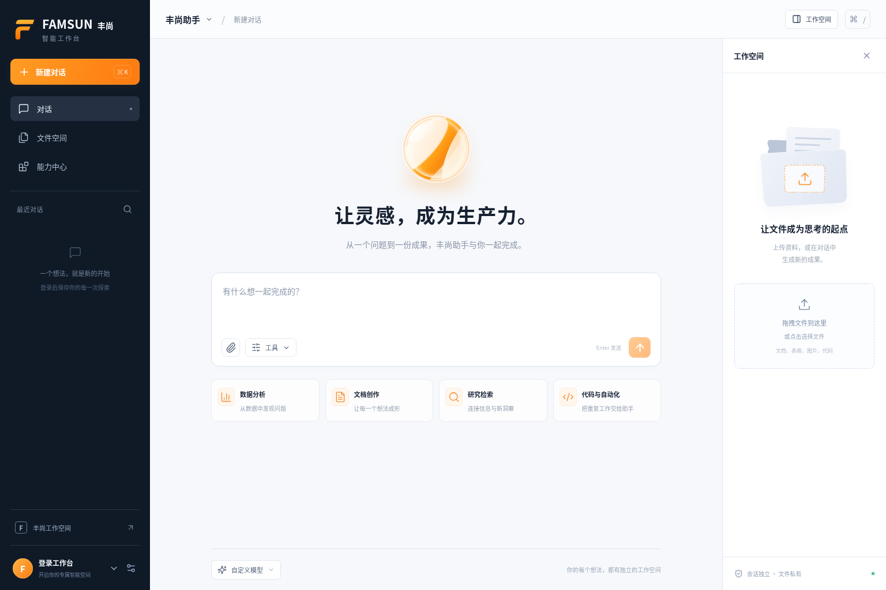

# 丰尚智能工作台 · FAMSUN Agent

基于 **OpenAI Agents SDK** 的多用户通用智能体工作台。浏览器里完成对话、资料上传、Python 分析、文件生成与预览；通过 Skills 和 MCP 扩展业务能力。支持 OpenAI 及实现对应协议的兼容模型服务。

前端使用 React、TypeScript、Vite，后端使用 Python、FastAPI、SQLAlchemy。默认本地 SQLite；提供 PostgreSQL 与 Docker 部署配置。



## 快速开始

需要 Python 3.12+、[uv](https://docs.astral.sh/uv/)、Node.js 22+。Python / Shell 执行还需要可访问的 Docker Engine。

```bash
cp .env.example .env
./scripts/dev.sh
```

打开 [http://localhost:5173](http://localhost:5173)。首次注册的账号成为管理员；默认关闭后续公开注册。后台 API 位于 [http://localhost:8000](http://localhost:8000)，接口文档位于 `/api/docs`。

没有模型密钥也可以启动页面、注册账号、管理会话与文件。发送模型请求会明确提示未配置，不会返回模拟回答。

要启用 Python / Shell 分析，先构建执行镜像：

```bash
docker build -t famsun-sandbox:latest sandbox
```

如果当前机器没有 Docker，可以在 `.env` 设置 `SANDBOX_BACKEND=disabled`。这保留对话与受限文件工具，但不会运行任何主机代码。

## 连接模型

按实际服务填写 `.env`，然后重启后端。密钥只保存在服务器环境，不发送给浏览器或代码执行容器。

```dotenv
AGENT_API_KEY=
AGENT_BASE_URL=https://api.openai.com/v1
AGENT_MODEL=gpt-4.1
AGENT_API_MODE=chat_completions
```

`AGENT_API_KEY` / `AGENT_BASE_URL` 也分别支持 `OPENAI_API_KEY` / `OPENAI_BASE_URL`。兼容服务应填写其实际 Base URL 和模型名称；管理员可在设置页调整端点、模型与 API 模式。

Base URL 是 API 根地址，不是完整请求地址。例如阿里云兼容接口使用
`https://dashscope.aliyuncs.com/compatible-mode/v1`，不要在末尾添加
`/responses` 或 `/chat/completions`。SDK 会根据 API 模式自动拼接请求路径，
填入完整接口地址会导致路径重复和 404。环境变量修改后需重启应用；如果管理员已在设置页保存地址，该设置优先于环境变量。

| 模式 | 适用情况 |
| --- | --- |
| `chat_completions` | 默认。服务需要支持流式 Chat Completions 与 function calling |
| `responses` | 服务明确实现 Responses API 时使用 |

“兼容 OpenAI”不保证兼容全部协议细节。工具调用、流式事件和结构化参数需要在目标供应商上验证。本应用的 Python 和文件工具由自己的执行环境提供，不依赖供应商的托管 Code Interpreter。

## 工作台能力

- **多用户工作区**：登录会话、会话归属检查、独立文件目录、所有文件读取均要求授权。
- **实时执行**：流式 Markdown、任务计划、工具调用记录、任务取消、MCP 工具审批，以及可重放的持久化执行事件。
- **文件与产物**：上传资料、展示生成文件、图片与文本等预览、授权下载。支持从一份 CSV 开始分析并生成图表与报告。
- **隔离执行**：每次代码执行使用独立 Docker 容器，只挂载当前会话目录；无网络、非 root、只读根文件系统、资源与时间限制。
- **扩展能力**：Skills 按需加载，MCP 使用允许的 HTTPS 服务，外部工具执行前要求审批。管理员管理扩展，用户控制自己的启用状态。
- **持久化**：用户、会话、消息、文件、任务与执行事件入库；刷新页面不会删除已有记录。

文件目录按 `DATA_DIR/workspaces/<user>/<session>/` 隔离。上传文件进入 `uploads/`，可交付产物进入 `outputs/`。代码容器在单次工具调用结束后销毁，工作区文件持续保留；Python 内存变量不跨工具调用保留。

## 扩展业务能力

在“能力中心”中以管理员身份添加 Skill，填写名称、说明和 Markdown 指令。建议将输入、处理步骤、输出格式、业务约束写清楚，避免把访问凭据写进 Skill。

```markdown
# 生产周报

适用于生产数据分析与周报。

1. 读取用户上传的表格，核对日期、产量、停机时间的字段与单位。
2. 先报告缺失数据，不擅自补造生产记录。
3. 使用 Python 汇总，输出趋势图和异常清单。
4. 将中文报告与处理后的表格写入 outputs/，引用生成文件。
```

要连接 MCP，先在服务器设置 `ALLOWED_MCP_HOSTS`，再由管理员在能力中心添加对应 HTTPS 端点。需要 Bearer 认证时，在服务器配置符合 `MCP_<NAME>_TOKEN` 格式的环境变量，并在扩展的 `token_env` 字段填写该变量名，不能填写密钥本身。仅添加扩展并不代表远端已连接成功；实际连接与工具调用错误会出现在任务记录中。

## 验证与部署

```bash
./scripts/check.sh
```

这会运行后端测试并构建前端。另有主动运行的真实 Docker 冒烟检查，不需要模型密钥：

```bash
docker build -t famsun-sandbox:latest sandbox
PYTHONPATH=backend uv run python tests/docker_smoke.py
```

它会在临时会话目录中将 CSV 转为 Excel 与 PNG 图表，并检查非 root、只读输入与根文件系统、禁网、无模型密钥、取消和执行超时；完成后清理临时产物。这条链路已在开发环境实际执行通过。真实模型端到端调用仍需要配置目标服务并验证。

生产部署见 [DEPLOYMENT.md](docs/DEPLOYMENT.md)，数据流与安全边界见 [ARCHITECTURE.md](docs/ARCHITECTURE.md)，业务扩展步骤见 [EXTENSIONS.md](docs/EXTENSIONS.md)，接口约定见 [API.md](docs/API.md)。

交付时的实际测试范围和复跑方式见 [VERIFICATION.md](docs/VERIFICATION.md)。

当前运行器采用**单 API 进程**管理任务。事件断线可以重连；进程重启会把未完成任务标记为中断，不会自动重复有副作用的工具调用。SSO、独立任务队列、多实例运行器及跨地域容灾仍需结合企业基础设施实施，不能仅增加 Uvicorn worker 数量来扩容。
