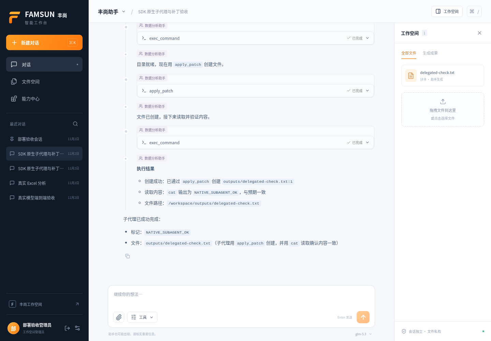

# 丰尚智能工作台 · FAMSUN Agent

基于 **OpenAI Python Agents SDK 0.24** 的多用户智能体工作台。浏览器中完成资料上传、对话、隔离代码执行、文件生成和预览，并通过可编辑的 Skills、MCP 和子代理扩展业务能力。

前端使用 React 19、TypeScript、Vite；后端使用 Python、FastAPI、SQLAlchemy。应用数据支持 SQLite / PostgreSQL，完整 SDK 会话历史保存在本地 SQLite。模型接入仅使用 **Responses API**。



## 快速开始

需要 Python 3.12+、[uv](https://docs.astral.sh/uv/)、Node.js 22+。执行智能体任务还需要可访问的 Docker Engine 和沙箱镜像。

```bash
cp .env.example .env
docker build -t famsun-sandbox:latest sandbox
./scripts/dev.sh
```

打开 [http://localhost:5173](http://localhost:5173)。API 位于 [http://localhost:8000](http://localhost:8000)，交互接口文档位于 `/api/docs`。首次注册创建管理员；默认关闭后续公开注册。

没有模型密钥时仍可注册、管理会话和文件；发送任务会明确提示未配置。`SANDBOX_BACKEND=disabled` 仅供账号、文件和界面调试，不能运行智能体，不会回退到宿主机执行代码。

## 连接模型

在 `.env` 填写实际服务配置并重启后端：

```dotenv
AGENT_API_KEY=
AGENT_BASE_URL=https://api.openai.com/v1
AGENT_MODEL=gpt-5.6-luna
AGENT_COMPACTION_THRESHOLD=32000
```

`AGENT_API_KEY`、`AGENT_BASE_URL` 分别支持 `OPENAI_API_KEY`、`OPENAI_BASE_URL` 别名。密钥只在服务端使用，不发送给浏览器或沙箱。管理员可以在设置页修改 API 根地址、模型和压缩阈值；已保存的设置优先于环境默认值。

Base URL 应为 API 根地址，不能带 `/responses` 等请求路径。运行器固定使用 `OpenAIResponsesModel` 和 `store=False`，本地管理历史，不依赖 OpenAI Conversations 或托管执行环境。旧 API 模式配置会归一为 Responses，应用不会自动切换协议。

兼容服务必须实际支持 Responses 流式事件、函数及 custom tools，以及原生 `context_management` / compaction。仅声明“OpenAI 兼容”不能证明支持这些能力；缺少能力时任务明确失败。压缩由模型服务完成，需按目标模型的上下文窗口设置阈值，并在部署环境验证。

## 工作台能力

- **多用户会话**：登录与资源归属校验，每个用户、每个聊天拥有独立文件目录和 SDK 历史。
- **SDK 原生执行**：`SandboxAgent` 使用 `Filesystem`、`Shell`、`Skills`、`Compaction`；通过 `exec_command` / `write_stdin` 执行命令，`apply_patch` 编辑文件，`view_image` 查看图片。`update_plan` 是保留的产品专用工具。
- **连续上下文**：`SQLiteSession` 保存消息和完整工具往返；原生压缩缩短模型上下文，`ToolOutputTrimmer` 在本地减少较早的大型工具输出。
- **子代理**：通过 SDK `Agent.as_tool()` 委派任务，独立任务上下文、共享当前聊天沙箱；可配置指令、模型、轮数及使用的 Skills / MCP。
- **有序过程与最终答复**：文字、工具、审批和子代理活动按事件顺序显示；执行过程可折叠，最终答案独立保留。持久化事件支持刷新后回放和 SSE 断线重连。
- **文件预览**：表格工作表、PDF 分页、Markdown / HTML、图片、文本 / 代码 / JSON、DOCX 文本以及浏览器支持的音视频。大型或不支持的文件保留授权下载入口。
- **能力编辑**：管理员创建、编辑、删除共享 Skills / MCP / 子代理；每位用户独立控制启用状态。远程 MCP 工具通过 SDK 原生审批机制先审批、后执行。

每次任务创建一个 SDK Docker 容器，任务中的工具和子代理共享该容器；结束、失败或取消时清理容器。文件保存在 `DATA_DIR/workspaces/<user>/<session>/`，跨任务保留。`uploads/` 只读，成果写入 `outputs/`。网络默认启用；容器以非 root 用户运行，限制 CPU、内存和进程数量，不挂载模型密钥、历史数据库、其他聊天或 Docker socket。

SDK 历史位于 `DATA_DIR/history/<user>/<session>.sqlite3`，在模型工作空间之外。即使应用数据库使用 PostgreSQL，这些历史文件仍需一起持久化和备份。

## 扩展业务能力

在“能力中心”添加 Skill，填写适用场景和 Markdown 工作指引；添加子代理，设置专门的任务指令和能力选择。原生 Skills 将指引放入当前沙箱，模型按需要读取，不会把所有正文预先加入每个请求。

连接企业系统时，先在服务器设置 `ALLOWED_MCP_HOSTS`，再添加 HTTPS MCP 地址。可选认证字段 `token_env` 只填写 `MCP_<NAME>_TOKEN` 格式的服务器环境变量名，不能填写密钥值。具体流程见 [扩展指南](docs/EXTENSIONS.md)。

## 验证与部署

运行本地检查：

```bash
./scripts/check.sh
```

该脚本运行 Python lint / 测试及前端类型检查 / 构建。真实 Docker 检查独立运行，不需要模型密钥：

```bash
docker build -t famsun-sandbox:latest sandbox
PYTHONPATH=backend uv run python tests/docker_smoke.py
```

模型端到端验收需要另外配置真实 Responses 服务；mock 协议测试不能代替供应商验证。实际执行过的检查以对应日期的验证报告为准，历史报告保留当时版本的结果。

- [部署与运维](docs/DEPLOYMENT.md)
- [架构与运行边界](docs/ARCHITECTURE.md)
- [Skills / MCP / 子代理](docs/EXTENSIONS.md)
- [API 与事件契约](docs/API.md)
- [SDK 能力复用审计](docs/SDK-CAPABILITY-AUDIT.md)

当前部署使用 **一个 API worker、一个应用副本**。不同用户和聊天可以并行运行，但同一聊天只允许一个活动任务。重启会将未完成任务标记为中断，不会自动重放可能有副作用的工具。横向扩容需要额外的持久任务队列、分布式调度和共享存储设计。
