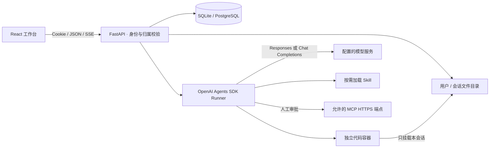

# 架构与运行边界

## 总体结构



应用把模型编排、业务数据访问和代码运行边界分开。Agents SDK 负责工具循环与模型协议适配；FastAPI 负责用户身份、任务状态、持久化、审批和事件流；Docker 负责执行模型产生的代码。

## 一次任务的生命周期

1. 浏览器提交消息及 `client_request_id`，服务器验证用户对当前会话和附件的访问权限。
2. 服务器拒绝同一会话的并发运行，并保存消息与任务。相同请求 ID 不重复创建任务。
3. 后台运行器读取会话上下文，向模型暴露启用的工具和 Skills。
4. 文本增量、工具开始与结束、审批请求和任务状态写入事件表。SSE 只是观察通道，断开连接不会主动取消任务。
5. 模型写入 `outputs/` 的安全普通文件被登记为产物。浏览器获得需要授权的下载 URL。
6. 成功、失败或用户取消后保存终态。应用重启时，对遗留运行中任务记录明确的中断状态。

## 用户、会话与文件隔离

数据库记录包含所有者标识，API 逐项检查归属。客户端传入的 session ID、file ID 或 run ID 都不作为授权凭据。下载接口与事件流同样要求登录和所有权检查。

工作目录形如：

```text
data/
  app.db                         # 本地 SQLite 模式
  workspaces/
    <user-id>/
      <session-id>/
        uploads/
        outputs/
```

文件路径经过规范化并限制在会话目录内，拒绝路径穿越、符号链接逃逸与非普通文件。服务端执行上传大小与会话容量限制。文件展示使用授权端点，HTML 等主动内容在隔离预览中处理。

## 代码执行

执行容器以当前应用用户的非 root UID / GID 运行。每次工具调用创建新的容器，共享本会话文件目录，但不共享 Python 进程内存。

容器使用只读根文件系统、只读上传目录、`no-new-privileges`、移除全部 capabilities、无网络、限制 CPU / 内存 / 进程数量，并设置超时和输出上限。模型密钥、其他用户目录和 Docker socket 不进入代码容器。常用数据分析和文档库在镜像构建时预装。

执行期限同时由应用监控和容器内部 `timeout` 进程执行，即使观察进程异常也不会无限等待。容器带有部署标签，应用启动时只清理本部署遗留的容器。默认部署标识由数据目录路径生成；同一 Docker 主机上多个部署应使用各自的数据目录，必要时显式设置不同的 `FAMSUN_DEPLOYMENT_ID`。

默认 Docker 后端不可用时执行会明确失败。应用不存在自动切换到主机 `exec` 的退路。`SANDBOX_BACKEND=disabled` 是显式禁用执行能力的模式。

Docker 容器共享宿主内核；它不是针对恶意租户的微虚拟机隔离。生产部署应把执行器放在专用节点，并根据威胁模型使用 gVisor、Kata 或远程沙箱。Compose 为了创建兄弟容器向控制面挂载 Docker socket；控制面因而具有较高宿主权限，不能与不受信任服务共用 Docker 主机。

## 模型兼容性

后端通过 `AsyncOpenAI` 客户端配置 `base_url` 和密钥，选择 Agents SDK 的 Chat Completions 或 Responses 模型适配器。兼容性依赖目标服务对选定协议、流式工具调用和 JSON 参数的实际支持。

本应用自己的文件和执行工具在两种模式下保持一致。模型服务不必实现 OpenAI 托管沙箱；模型也不会收到其他用户的文件路径。供应商特有的联网搜索、图像生成或业务 API 可以通过允许的 MCP 或新增服务器工具接入。

运行器提供计划更新、文件列表、文本读写、Python、Shell、图片读取和 Skills 加载工具。图片读取面向支持视觉输入的模型；端点是否接受相应图像格式仍由供应商能力决定。任务计划同时保存为 `outputs/task-plan.json`。

每次任务最多加载最近 60 条、总计 100,000 字符的历史消息。超过时会在执行记录和模型上下文中明确说明裁剪，数据库内的完整记录不变。当前没有自动长期记忆或语义摘要压缩；不能据此宣称无限上下文。SDK 远程 tracing 默认关闭，避免把任务内容自动发送到额外的追踪服务。

## Skills 与 MCP

Skills 是可审核的 Markdown 指令，按需要加载，避免把所有业务知识一次性塞进提示词。当前管理入口是能力中心与扩展 API；部署目录中的任意 Markdown 不会被悄悄当作可信指令执行。

MCP 端点必须满足 HTTPS 与服务端允许域名配置。外部工具执行需要用户审批，拒绝会反馈给运行器。审批发生在工具执行之前。Skills 与工具描述均属于可影响模型的输入；组织仍需审核启用的扩展来源与访问权限。

带认证的 MCP 可指定 `token_env`，仅允许引用 `MCP_[A-Z0-9_]+_TOKEN` 格式的服务器环境变量。运行器在建立连接时读取 token 并构造 Bearer header；变量值不进入提示词、事件和浏览器响应。也兼容 `FAMSUN_MCP_TOKENS` 中按扩展 ID 映射的 JSON 配置。缺少指定变量会明确报连接配置错误，不会悄悄降级为匿名调用。

## 当前并发与持久化模型

同一个 API 进程可处理不同用户、不同会话的异步任务。同一会话只允许一个活动任务。数据库保存执行记录，但任务对象与等待中的协程属于进程内存。

因此部署仅运行 **1 个 Uvicorn worker / 1 个应用副本**。不能通过增加 worker 数来获得可靠多实例执行。后续横向扩展应增加持久任务队列、分布式任务锁、专用运行器、对象存储和统一 SSE 事件总线，再启用多 API 副本。

## 接口与目录

`/api/auth/*` 处理身份，`/api/sessions/*` 处理会话，`/api/runs/*` 处理任务、取消与审批，`/api/files/*` 处理产物，`/api/extensions/*` 处理 Skills / MCP，`/api/settings` 处理管理员配置。完整模型以运行时 `/api/docs` OpenAPI 文档为准。

```text
backend/app/     HTTP API、持久化、认证、运行器与沙箱
backend/tests/   后端与隔离边界测试
frontend/src/   界面、API 客户端与交互状态
sandbox/        代码执行镜像与锁定依赖
scripts/        本地启动与检查
docs/           架构与部署
```
