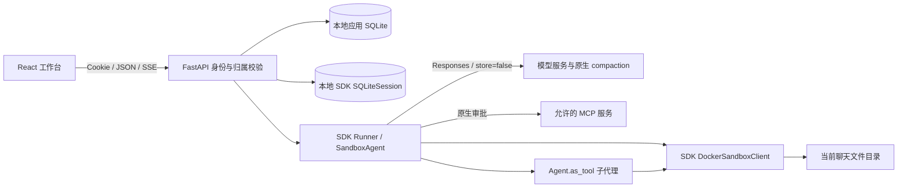

# 架构与运行边界

## 组件职责



Python Agents SDK 0.24 负责模型 / 工具循环、沙箱工具、Skills、会话项目持久化、压缩、委派、审批恢复和原始流事件。应用负责登录、资源归属、能力配置、任务生命周期、文件注册、浏览器预览与有序执行记录。

`backend/app/runtime.py` 组合 SDK 组件；`runtime_history.py` 管理本地历史位置和旧消息迁移；`runtime_events.py` 把 SDK 事件转为产品事件。`sdk_sandbox.py` 的 Docker 创建策略适配器只补充可信会话 bind mount、资源与安全参数，命令、PTY、补丁和生命周期仍由 SDK 执行。

## 一次任务

1. API 验证用户、聊天、附件和 `client_request_id`；同一聊天已有活动任务时返回冲突。
2. 应用保存当前 user 消息与 AgentRun，后台打开该聊天的 SDK 历史和独立 Docker 会话。
3. 首次迁移旧聊天时，把既有 user / assistant 文本加入空的 SDK Session。之后 SDK Session 是模型历史来源，每轮只提交最新 user 输入。
4. Runner 使用启用的原生能力、MCP 和子代理。普通工具由 SDK 调用；MCP 需要审批时返回 interruption，应用等待授权决定，再用同一 Session 和 `RunState` 恢复。
5. 文本与工具事件写入 `RunEvent`；工具完成及任务结束时扫描 `outputs/`，把安全普通文件登记为产物。
6. 成功时独立保存最终 Message，事件记录最终 item ID；失败和取消保留已有执行过程。沙箱始终走清理路径，聊天文件继续保留。

SSE 是观察通道；断开浏览器连接不会取消任务。取消通过独立 API 触发，运行器取消模型流、等待 SDK 清理并删除本次沙箱。

## 数据和授权

```text
DATA_DIR/
  app.db                              # 默认应用 SQLite 数据库
  history/
    <user-id>/<session-id>.sqlite3     # SDK 完整会话项目，始终本地保存
  workspaces/
    <user-id>/<session-id>/
      uploads/                        # 容器内只读
      outputs/                        # 可交付成果
      .famsun-skills/                  # 每次运行重新准备的技能文件
```

Session ID 是查找标识，不是授权凭据。FastAPI 对会话、任务、审批、文件、SSE 和 JSON timeline 逐项检查所有权。SDK 历史数据库位于沙箱挂载目录之外，模型不能直接读取或修改它。

应用 `Message` 保存用户界面中的对话和最终答案；SDK `SQLiteSession` 保存完整模型项目，包括工具 call / output。`RunEvent` 保存可重放的执行视图。三者用途不同，不能用 UI 文本重新构建每一轮模型历史。删除聊天会清理其关联记录、文件和本地 SDK 历史。

路径与文件访问拒绝目录穿越、符号链接逃逸和非普通文件；上传受文件大小与聊天容量限制。应用数据库统一使用 SQLite，启用 WAL、外键约束和 30 秒锁等待；数据库备份与整个 `DATA_DIR` 必须保持一致，包括本地 SDK 历史。

## 沙箱与网络

每次任务创建一个原生 Docker sandbox session；主代理、子代理和连续工具调用共享它。任务结束后容器删除，只保留绑定的聊天文件。普通命令是独立进程，不提供持久 Python notebook 内核；持续运行的命令由 SDK `write_stdin` 等接口跟进。

创建策略配置非 root UID / GID、只读根文件系统、只读 `uploads/`、`no-new-privileges`、移除 Linux capabilities、默认 2048 MiB 内存、2 CPU、256 个进程和文件句柄 / 文件大小限制。`/tmp` 为 512 MiB 私有 tmpfs；SDK 原生辅助程序需要执行权限，因此此目录允许 exec，并保留 nosuid / nodev。

网络启用，模型可执行任务需要的网络请求。MCP 主机允许列表只限制 MCP 连接配置，不是整个沙箱的网络防火墙。运行环境只注入受控变量；管理员可显式挂载只读 CA 证书包，Docker 客户端可采用管理员的代理默认值。模型 API 密钥、聊天历史、其他用户目录及 Docker socket 不进入执行容器。

`SANDBOX_BACKEND=disabled` 禁止智能体运行；没有主机执行回退。启动时只清理本部署标签下的遗留容器。Docker 共享宿主内核；Compose 控制面持有 Docker socket 的权限，应部署在专用主机，并按实际租户威胁模型决定是否增加更强隔离。

## 模型、历史和压缩

固定使用 `AsyncOpenAI` + `OpenAIResponsesModel`，设置 `store=False`。应用不使用远端 Conversation ID 维持历史，也不使用托管代码执行沙箱。目标端点必须支持流式 Responses、原生函数 / custom tools 和 `context_management`。

语义压缩采用 SDK `Compaction(StaticCompactionPolicy(...))`，阈值默认 32,000，可通过环境或管理员设置修改。SDK 向服务端请求 compaction，并在返回 compaction 项后缩短后续模型输入；这不是本地摘要模型，也不等同于删除数据库中的旧消息。服务端不支持该协议时明确失败，不静默改成截断或其他 API。

另外使用 SDK `ToolOutputTrimmer`，保留最近两轮，对较早超过 8,000 字符的工具输出提供最多 2,000 字符预览。这是本地输入过滤，不额外调用模型，不替代语义压缩。UI 消息和执行记录保持独立。远程 tracing 默认关闭。

## Skills、MCP 和子代理

管理员维护共享扩展，用户分别启用或停用。SDK `Skills` 把所选指引准备为沙箱文件，并向模型提供目录；模型按需读取 `SKILL.md`。当前管理表单保存 Markdown，不是任意技能安装器。

MCP 使用 SDK `MCPServerStreamableHttp`。应用检查 HTTPS、准确主机允许列表、URL 与凭据引用；SDK 在每次远程工具执行前暂停审批。用户拒绝后模型收到拒绝结果。`token_env` 引用服务器的 `MCP_<NAME>_TOKEN`，值不会进入提示词或浏览器；也支持现有部署的 `FAMSUN_MCP_TOKENS` 映射。

子代理由 `Agent.as_tool()` 创建，拥有独立任务输入和所选 Skills / MCP；未指定模型时继承主模型。它们共享当前聊天沙箱，能协作处理文件，但不是相互隔离的租户。子代理不绑定主聊天 Session，也不递归获得委派工具。其流事件带 `parent_call_id`，答案作为工具结果返回主代理，主代理继续给出用户最终答复。

## 有序事件与文件预览

SDK 原始 Responses / RunItem 事件统一映射为持久化事件，以递增 `RunEvent.id` 排序。文本使用 `item_id`，工具使用 `call_id`，子代理附带 `agent_id` 和 `parent_call_id`。同名工具并发时不能按名称配对。原始与 SDK 汇总事件去重；private reasoning 和 compaction 加密内容不进入浏览器记录。

SSE 和 `/api/runs/{id}/timeline` 返回同一批事件。前端使用同一 reducer 还原过程，`text.completed` 是文本权威内容，`text.phase` 识别最终答案，`run.completed` 关联最终 Message。历史和实时视图都把执行过程与最终答复分开。

Office 预览在独立的受限解析进程中处理已授权文件描述符，返回表格值、DOCX 有序正文/表格/内嵌图片，以及 PPTX 幻灯片的文字、简单形状、表格、图片和坐标。解析器不运行公式、宏或外部链接；它有文件、解压体积、行列、文本、图片字节/像素/数量、时间和内存上限。此进程是解析资源隔离，不是模型执行的 Docker 沙箱。预览不复刻全部 Office 排版，遗漏或简化的内容有相应提示，原文件仍可下载。

HTML 在 2 MiB 读取上限内使用完整内容，源码视图单独截断。DOMPurify 保留内联脚本和事件后，内容只进入 `sandbox="allow-scripts"` 的 srcdoc iframe；不启用 `allow-same-origin`，因此无法读取应用 DOM、Cookie 或存储。子文档 CSP 限制脚本、图片、样式、连接和嵌套框架；父应用的 HTTP CSP 与入口 HTML meta 同时设置 `frame-src 'none'`，阻止 iframe 自行导航到外部页面。只设置子文档 CSP 不足以保证这个导航边界。文件读取接口直接打开时继续使用禁止脚本的 CSP；下载返回原始字节。前端通过带登录态的请求检查 HTTP 状态后保存原始 Blob，失败时显示错误，关闭预览不会取消已经请求的下载。PDF 在浏览器分页呈现，音视频取决于浏览器支持的格式。

## 运行拓扑

当前调度、取消和审批等待使用进程内协程。每次 SDK 运行使用独立的工作线程事件循环，避免 Docker 同步 I/O 阻塞 API 主循环；事件和审批回传主循环处理，取消会等待原生资源清理。一个 API 进程可以并发处理多个用户 / 聊天，同一聊天只允许一个活动任务；默认每用户最多三个、全服务十六个。

部署保持 **一个 Uvicorn worker、一个应用副本**。数据库共享不意味着调度已支持多实例。进程重启会把遗留活动任务标记为中断，不自动重新执行工具。横向扩展需要先引入持久队列、分布式任务所有权与锁、共享文件存储和事件分发。
