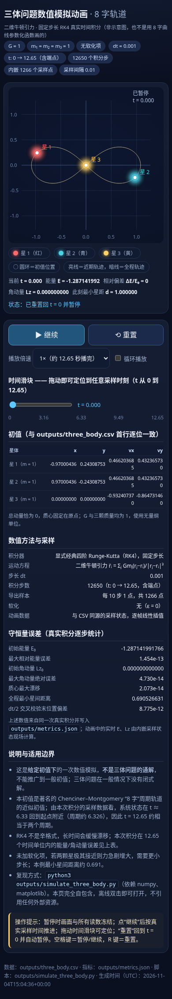

# 运行稳定性、下载与真实三体验收

[返回当日报告](../README.md) · [全部测试报告](../../README.md)

测试日期：2026 年 11 月 4 日，北京时间（UTC+8）。原始 JSON 保留 UTC 时间，本文时间已换算为北京时间。本批次独立于同日的 `complex-regression`，保留首次生成结果、问题及后续修订，避免把修订后的结果写成一次成功。

**修复、真实生成与最终交付验收完成。** 后端 250 项、Node 25 项测试通过；首次生成及修订后的独立数值检查均为 51 项通过，4 个真实浏览器场景通过。两轮真实任务共 37 轮模型响应、39 次工具调用、962 条持久化事件，未发生意外后端重启。当前供应商原生上下文压缩仍未验证通过，详见优化项。

最终文件：[交互 HTML](artifacts/three-body/three_body.html) · [轨迹 PNG](artifacts/three-body/three_body.png) · [CSV](artifacts/three-body/three_body.csv) · [指标](artifacts/three-body/metrics.json) · [复现脚本](artifacts/three-body/simulate_three_body.py)。

## 修复内容与验证边界

开发启动命令原来使用 `uvicorn --reload`，未限定监控目录。会话工作空间处于项目目录下，模型生成或修改 Python 文件会落入开发重载范围，从而重启 API、中断正在运行的任务。本次把监控范围收窄为 `backend/app`。实际验证中，写入产物 Python 文件后进程号保持 `4636`，触碰后端源码后变为 `9165`：生成文件不再触发重启，源码热重载仍有效。[重载验证](evidence/reload-verification.json)

`.env.example` 中含空格的 `AGENT_TRACING_WORKFLOW_NAME` 增加引号，并检查环境文件的 shell 解析方式。该修复避免把名称中的后半部分误读为命令；验证及归档不输出 API 密钥。

执行上限统一经 `Settings → RunService → RuntimeConfig → SDK/Docker` 传递。默认限额增加，但全部保持有限且可配置。未设置独立轮数的子代理继承主助手上限；历史内置子代理只在名称、描述和完整配置仍与旧默认一致时迁移，管理员已有的限制或自定义指令保留。上传配额按实际工作空间扫描，涵盖尚未登记为产物的文件，不再仅依赖数据库中的文件大小汇总。

下载问题的基线需要区分：**在本次 Chromium 环境里，原版合法登录用户从文件列表和预览弹窗下载 HTML 均成功，未复现用户原环境中合法下载失败的全部条件。** 实验也排除了“现有文件 CSP 必然阻止 HTML 附件下载”的假设。实际复现的是：保留弹窗并退出登录后，原生下载链接不检查 HTTP 错误，触发 `content.json` 错误文档下载尝试，应用没有错误反馈。不能据此认定用户原故障就是登录过期。[基线记录](evidence/download-regression/baseline-characterization.json)

两个下载入口现共用组件：先验证安全 URL 和 HTTP 状态，再以原始字节生成 `application/octet-stream` 下载，保留中文文件名；错误显示在应用内，重新登录后可重试。下载启动后关闭弹窗或筛掉文件仍可继续。该生命周期行为是在独立审查发现早期实现的取消问题后修正，并补充延迟网络回归。后端鉴权、文件 CSP 和 HTML 预览的 iframe 隔离未放宽。[下载验收摘要](evidence/download-regression/summary.json)

## 执行预算

容量单位为 MiB（1024² 字节），时间为秒。表格记录本次代码默认值，环境变量可覆盖；上下文压缩阈值仍为 32,000，与执行时间、轮数预算分别控制。

| 配置项 | 原默认值 | 本次默认值 | 环境变量/配置来源 |
| --- | ---: | ---: | --- |
| 主助手最大轮数 | 40 | 200 | `AGENT_MAX_TURNS` |
| 整次任务最长时间 | 900 | 7200 | `AGENT_TIMEOUT_SECONDS` |
| 模型客户端请求超时 | 90 | 300 | `AGENT_MODEL_TIMEOUT_SECONDS` |
| 计划最大步骤数 | 12 | 50 | `AGENT_MAX_PLAN_STEPS` |
| 单文件上传/产物登记限制 | 25 MiB | 100 MiB | `MAX_UPLOAD_MB` |
| 会话工作空间容量 | 250 MiB | 2048 MiB | `MAX_SESSION_MB` |
| 工作空间目录项上限 | 1000 | 10000 | `MAX_WORKSPACE_ENTRIES`；目录和链接也计数 |
| MCP HTTP 超时 | 20 | 120 | `MCP_TIMEOUT_SECONDS` |
| MCP 会话超时 | 30 | 300 | `MCP_SESSION_TIMEOUT_SECONDS`，也传入 SSE 读取超时 |
| MCP 列表最大页数 | 10 | 100 | `MCP_MAX_LIST_PAGES` |
| 内置子代理最大轮数 | 12 | 继承主助手 | 管理员可保存独立值；空值表示继承 |
| Docker 请求超时 | 60 | 180 | `FAMSUN_DOCKER_TIMEOUT_SECONDS`；可配置 1–3600 |
| 沙箱内存/含交换内存总限额 | 512 MiB | 2048 MiB | `FAMSUN_SANDBOX_MEMORY_MB`；两者设为相同值 |
| 沙箱 CPU | 1 | 2 | `FAMSUN_SANDBOX_CPUS` |
| 沙箱进程数 | 64 | 256 | `FAMSUN_SANDBOX_PIDS_LIMIT` |
| 沙箱打开文件数 | 256 | 4096 | `FAMSUN_SANDBOX_NOFILE` |
| 沙箱单文件内核限制 | 50 MiB | 100 MiB | `FAMSUN_SANDBOX_FILE_MB` |
| 沙箱 `/tmp` | 128 MiB | 512 MiB | `FAMSUN_SANDBOX_TMP_MB` |

工作空间字节/目录项监测和产物扫描保持有界。周期性扫描通过线程执行；工作空间容量监测不是文件系统强制磁盘配额。沙箱仍使用非 root 用户、只读根文件系统、`cap_drop=ALL`、`no-new-privileges`，且不挂载 Docker socket 或宿主凭据。[实际容器策略](evidence/live-container-policy.json)

## 回归结果

| 检查 | 结果 | 证据类型与范围 |
| --- | --- | --- |
| 后端检查与测试 | 250 项通过，9.53 秒 | API、配额、迁移、执行参数、SDK 协议/取消等；含模拟供应商响应，不能代替真实模型验收。[日志](evidence/checks.log) |
| 新增服务配置/迁移专项 | 2 项通过，1.18 秒 | 服务到运行时的预算传递、旧内置子代理迁移幂等性；单独复跑记录，本文不额外叠加至 250 项总数。[日志](evidence/service-checks.log) |
| Node 单元测试 | 25 项通过 | 时间线、文件链接、预览数据及工具展示等纯前端逻辑。[日志](evidence/frontend-unit.log) |
| TypeScript 与生产构建 | 通过 | `typecheck` 与 `build`；保留 PDF chunk 超过 500 kB 的 Vite 提示。[日志](evidence/checks.log) |
| 下载专项浏览器回归 | 通过 | 真实临时后端、Cookie 登录和 Chromium，无 API mock、无模型调用；两个入口、中文文件名、原字节、401/404、权限、重试及关闭/过滤后的持续下载。[日志](evidence/download-regression/browser.log) |
| 预览浏览器回归 | 通过 | 人工文件及模拟前端数据；覆盖交互 HTML 隔离、更新中的预览、表格、文档、图片、移动端等，不作为真实模型成果证据。[日志](evidence/download-regression/previews.log) |
| 渲染/界面浏览器回归 | 通过 | 人工/模拟数据覆盖工具输出、产物修订/删除、历史回放、移动布局与会话切换。[渲染](evidence/download-regression/rendering.log) / [界面](evidence/download-regression/ui.log) |
| 原生 Docker 烟测 | 通过 | 实际 SDK 沙箱容器内写出 60 MiB 文件，验证突破旧 50 MiB 内核限制；并核对内存、CPU、PID、打开文件数、文件大小和 tmpfs 策略。没有调用模型。[日志](evidence/docker-smoke.log) |
| 代码独立审查 | 已关闭已发现问题 | 早期下载组件卸载时中止下载的回归已修复；复审未发现剩余可操作问题。未进行第二次重复全量测试。 |

前端浏览器套件中的内嵌单元测试与 25 项 Node 总数有重叠，不相加作为“更多通过数”。

## 真实模型任务与运行环境

本次在测试环境启动开发服务：API `127.0.0.1:8000`，Vite 前端 `127.0.0.1:5173`。运行使用 **`qwen3.8-flash`、Responses API、OpenAI Python Agents SDK 0.24 和真实 Docker 沙箱**；没有把 Chat Completions 回退、宿主执行或模拟供应商结果计入真实验收。

浏览器完成登录、创建会话、上传初值文件、发起三体任务，在任务运行中打开上传文件预览，并在结束后预览、下载产物。首次运行浏览器错误数组为空。完整会话操作及逐项预览由[首次浏览器记录](evidence/three-body/report.json)保留。

| 首次运行指标 | 实测值 |
| --- | --- |
| Run ID | `c1933a6866ae451189ccb4f809ebef24` |
| 提交时间（北京时间） | 2026-11-04 22:48:24.538 |
| 浏览器记录完成时间（北京时间） | 2026-11-04 23:08:34.609 |
| 运行耗时 | 1210.071 秒，约 20 分 10 秒 |
| 结果 | 运行状态 `completed`；交付 5 个文件 |
| 已观测模型响应轮数 | 32；以 `context.status`/响应完成事件划分 |
| 工具调用 | 35；均有成对开始/完成事件，但不等于每次工具都成功 |
| 持久化事件 | 577；序号有序且唯一，没有重复或未配对的工具事件 |
| 最长相邻事件间隔 | 142.016 秒 |
| 工具执行区间合并时长 | 66.864 秒；多个并行工具区间不重复累计 |
| 最大单轮输入 token | 82,663 |
| 各响应输入 token 观测值累计 | 1,813,231；不是唯一上下文大小，也不是账单结算值 |
| 超过 32,000 阈值的响应 | 26 |
| 原生 compaction item | 0；真实供应商压缩仍未验收通过 |

[逐轮模型与工具记录](evidence/agent-loop-report.md)列出每轮响应、调用参数、实际工具输出及诊断；[机器可读分析](evidence/agent-loop-analysis.json)保留计算来源。轮间时间包含前一轮工具执行、模型生成、流式传输和未独立计时的应用开销，不能全部归因为供应商延迟。输出 token 的完整统计当前不可得。

首次生成的五个原件保存在 `artifacts/initial-three-body/`；最终修订件保存在 `artifacts/three-body/`，两组原始下载文件均保留。

| 文件 | 内容 | 首次原件 |
| --- | --- | --- |
| `simulate_three_body.py` | 可复现 RK4 积分及生成器 | [Python](artifacts/initial-three-body/simulate_three_body.py) |
| `three_body.csv` | 1266 行轨迹采样，包含初值和终值 | [CSV](artifacts/initial-three-body/three_body.csv) |
| `metrics.json` | 守恒量、最近距离、步长减半对照 | [JSON](artifacts/initial-three-body/metrics.json) |
| `three_body.png` | 轨迹、分面及数值诊断图 | [PNG](artifacts/initial-three-body/three_body.png) |
| `three_body.html` | 自包含中文交互动画 | [HTML](artifacts/initial-three-body/three_body.html) |

## 数值结果、已发现产物问题与修订

初值来自上传文件，`G=1`、三颗质量均为 1。生成器采用二维牛顿引力、无软化的固定步长 RK4，`dt=0.001`、`t∈[0,12.65]`，每 10 步导出一个样本。以下是**首次下载的 `metrics.json` 中的生成结果**，与下文的独立复算分别记录，避免仅凭模型自己的“通过”文字完成科学验收。

| 指标 | 首次产物数值 |
| --- | ---: |
| 积分推进步数 | 12,650（含初态共 12,651 个状态） |
| CSV 数据行数 | 1,266 |
| 初始总能量 | −1.2871419917663258 |
| 最大相对能量误差 | 1.4542575966691299 × 10⁻¹³ |
| 最大绝对角动量误差 | 4.729550084903167 × 10⁻¹⁴ |
| 最大质心位置模 | 2.072521595751318 × 10⁻¹⁴ |
| 最小两两距离 | 0.6905266306918849 |
| `dt/2` 终点位置最大差 | 8.775451285775171 × 10⁻¹² |

独立检查于北京时间 **23:10:32.705** 完成，**51 项全部通过**。检查直接读取下载的 CSV、metrics 和 HTML，使用独立的纯 Python 牛顿引力/RK4 实现，没有执行模型生成脚本。按原 `dt=0.001` 重算全程守恒量，并以 `dt=0.0001` 积分取 51 个参考状态；对 CSV 的最大位置误差为 **8.3249 × 10⁻¹²**，最大速度误差为 **1.5522 × 10⁻¹¹**。CSV 结构、有限值、初值、时间间隔、无碰撞、metrics 必需字段及逐步统计均通过指定容差；HTML 全部 1266 行内嵌样本与 CSV 的最大绝对差为 **4.9999 × 10⁻¹³**，无外部资源引用。[独立物理检查](evidence/baseline-physics-verification.json)

CSV 每 0.01 时间单位采样，而 metrics 对每个 0.001 积分状态统计，二者的最大误差/最小距离数值不必逐位相同。独立检查分别保留 CSV 复算值和全步长重积分值；浮点实现产生的小差异按证据中的容差判断，没有用舍入后的“相等”替代验证。

模型在沙箱内还编写了 Python 核验和 Node DOM stub 交互核验，最终答复称 37 项及 16 项通过；其实际过程保留在工具记录中。DOM stub 结果并不覆盖真实浏览器布局，模型自己的检查也没有发现全部内容问题。

独立浏览器检查发现两项具体问题：

1. HTML 和最终答复把这组初值的周期写成“约 6.916”，与该轨道不符。修订要求删除未经估算的数字，或使用有依据的约 6.3259，并同步修改生成器中的模板。
2. 390 px 手机视口中，应用父页面没有横向溢出，但 HTML iframe 的可用宽度为 360 px、文档宽度为 367 px，内部多出 7 px。修订要求让网格与长文本可收缩/换行，不以隐藏溢出来掩盖内容裁切。[首次布局测量](evidence/three-body/running-html-inspection/inspection.json)

后续真实修订运行 `4793b4db26e54e8cb4d91b2c625f1981` 于北京时间 **23:08:39.387** 提交。任务限定只改 HTML 及生成器模板，不重新积分、不重绘 PNG，保留 CSV、metrics、PNG 的 SHA256 及 HTML 内嵌 1266 行数据；要求最多 4 次工具调用后结束。[修订记录](evidence/three-body/repair/report.json)

修订于北京时间 **23:14:56.655** 完成，耗时 **377.268 秒**，5 轮响应、4 次工具调用、385 条事件，工具均成功。最高输入为 101,697 token，5 轮全部超过压缩阈值，仍无 compaction；工具执行区间合计仅 1.567 秒，不能把其余耗时直接视作工具阻塞。[修订逐轮记录](evidence/repair-loop-report.md)

独立比较确认 CSV、metrics、PNG 的 SHA256 完全不变，HTML 内嵌数据 JSON 的原始字节也保持一致；只有 HTML 和生成器模板发生预期修改。最终 HTML 为 260,897 字节，SHA256 为 `53fd0f61288da24bce222508ee80dd9f4997714a6c01ad39c75cf61cabc2ad0e`。[完整哈希比较](evidence/hash-preservation.json)。最终下载文件重新执行独立物理验证，**51 项全部通过**。[最终数值验收](evidence/physics-verification.json)

真实 Chromium 验收 **4/4 场景通过**：应用内桌面/手机 iframe，以及离线桌面/手机。测试跟踪三颗星的实际像素位置，确认继续后星体移动、暂停后保持静止、拖动滑块改变时刻、重置回零并暂停。手机应用宽度为 390/390 px，iframe 文档为 360/360 px；离线手机为 390/390 px，均无横向溢出。最终周期文案改为约 6.326，HTML 数据与 CSV 在既定浮点容差内一致。点击真实下载按钮所得文件与 API 原字节一致，无 pageerror 或 console error。[浏览器证据及截图](evidence/three-body/html-verification/evidence.json)

浏览器策略禁止直接 `file://` 导航，因此离线验证使用下载文件原文 `setContent`，关闭网络且确认零外部请求；这证明自包含离线执行，不冒充实际双击文件测试。仅见测试读回 canvas 像素触发的性能提示和开发工具信息。另有 3 次 GET 在组件挂载阶段被取消，均非下载请求；已用带阶段标记的复现区分加载/挂载与用户关闭，没有把取消请求记作下载失败。

修订后的聊天答复还有一处措辞不严谨：把 t≈6.33 称为 t>0 的最小状态距离，但其自身表格在 t=12.65 的距离更小；准确说法是“首个回归区间约在 6.33”。最终 HTML、CSV、指标并无此矛盾，未为这一聊天措辞再触发额外模型任务。

## 服务响应性

有效探针覆盖北京时间 **22:49:05.617—23:17:15.741**，包含首次运行、局部修订和后续验收。对本机 `/health` 的 **3360 次请求全部成功**，失败 0；中位数 1.887 ms，P95 2.626 ms，P99 4.151 ms，最大 139.080 ms；超过 100 ms 的请求 1 次，超过 500 ms 为 0。[响应性摘要](evidence/health-summary.json)

采样覆盖限制：有效采样开始于首次任务提交后约 41.1 秒；23:04:52.765—23:05:02.326 有约 9.56 秒的采集器重启缺口。这些是观测缺口，不是应用宕机。完成后确认后端仍为源码重载测试后的进程 `9165`，启动日志无 ERROR/Traceback，全部任务沙箱容器已经清理。[生命周期检查](evidence/lifecycle-verification.json)

这说明本次长任务期间 API 仍能响应健康检查，不能替代远程用户、反向代理、所有业务接口或最大规模文件库存的压力测试。健康检查包含数据库读取，数值也包含本机客户端开销。初始一组探针因执行环境拒绝套接字访问而未到达应用，已单独标记无效，不计为应用故障或纳入有效统计；保留该排除原因以便追溯。

## 仍需优化的事项

| 优先级 | 观察与证据 | 建议及本次处理范围 |
| --- | --- | --- |
| 高 | 26 轮响应输入超过 32,000，原生 compaction item 为 0，最大输入 82,663 token；大量代码/补丁参数及失败重试保留在历史中 | 单独验证当前供应商 Responses 原生压缩行为和 SDK 接入。现有 `ToolOutputTrimmer` 只裁剪工具输出，不压缩长调用参数；本次没有新增替代记忆机制，增加任务预算不能宣称解决上下文增长。 |
| 中 | 20 分钟任务中工具区间约 66.9 秒，最长可见事件空白 142 秒 | 增加“模型生成中”的可靠状态与观测；按提供方响应指标定位延迟，避免把全部空白当成应用卡死。 |
| 中 | 两次 `apply_patch` 请求失败后重试；若干额外自检反复修正 | 改善工具格式提示及首错后的恢复策略；记录真实失败，不以最终成功覆盖过程。 |
| 中 | POSIX shell 不支持所用语法、测试脚本语法错误；有命令最后执行 `echo` 导致外层退出码 0，内层仍报告失败 | 工具结果判定同时检查实际命令结构、内部退出码和断言，防止“命令完成”误判为验证通过。 |
| 中 | 生成器和校验脚本多次运行、反复追加验证，仍遗漏周期文案及手机布局问题 | 设置有界验收清单和明确停止条件；对有科学/交互要求的产物优先做独立数值检查及真实浏览器验证。局部修订已明确限制调用次数。 |
| 低 | 首次绘图出现字体回退警告，后续模型调整后重新生成 | 保留首次警告与后续产物；最终 PNG 文字与轨迹已进行视觉检查。 |
| 低 | 两次模型最后响应到任务完成分别约 10.51/10.45 秒 | 增加 SDK 清理和线程退出的阶段计时，再判断是否存在可优化等待，当前不推断具体原因。[完整观测](evidence/observer-findings.md) |
| 低 | 构建中 PDF chunk 约 501 kB，Vite 提示超过 500 kB | 构建成功；后续可评估拆包/加载策略，本批次不通过调高警告阈值掩盖提示。 |

代码审查还识别出规模边界：虽然工作空间扫描在线程中进行，服务对已登记产物的逐一核对仍有同步文件操作；本次健康检查不覆盖 10,000 项库存下的最坏暂停时间，不据此声称已经做过大规模负载验收。

## 交付与归档说明

已从既有默认分支提交 `4a0bcf5ddc562b821ccc0d84d23391c63745c50b` 创建 [main](https://github.com/zlstart/codex_cloud/tree/main)，并核对远端引用。将 `main` 设为 GitHub 默认分支时，GitHub 返回 HTTP 403 `Resource not accessible by integration`，现有集成缺少该设置的写权限；这不是代码错误或自动审批拒绝。默认分支仍需通过具有管理权限的连接/仓库设置修改，修复 PR 可独立以 `main` 为目标。修复分支为 `fix/agent-runtime-downloads`，PR 以 `main` 为目标；未自动合并。

本批次归档按以下目录组织；归档前已核对链接并扫描已配置凭据。没有归档认证状态、Cookie、账号口令、密钥、应用数据库或整个会话工作目录。

| 目录/入口 | 内容 |
| --- | --- |
| `evidence/checks.log`、`evidence/docker-smoke.log` | 经检查的回归与真实容器执行证据 |
| `evidence/download-regression/` | 下载基线、验收摘要及浏览器回归日志 |
| `evidence/agent-loop-report.md`、`evidence/agent-loop-analysis.json` | 首次运行逐轮模型/工具记录及汇总 |
| `evidence/three-body/` | 首次任务、修订任务和独立检查的结构化记录 |
| `evidence/health-summary.json` | 有效健康检查统计及测量限制 |
| `artifacts/initial-three-body/` | 首次五项下载原件，保留发现问题时的状态 |
| `artifacts/three-body/` | 修订及真实浏览器验收后的最终五项下载原件 |
| `screenshots/three-body/` | 发起任务、运行中预览、最终答复、产物与布局证据 |

截图入口：[提交任务](screenshots/three-body/01-prompt-and-upload.png)、[运行中预览](screenshots/three-body/02-running-upload-preview.png)、[首次最终答复](screenshots/initial-three-body/03-final-answer.png)、[首次 HTML 预览](screenshots/initial-three-body/04-output-4-html.png)。修订后截图另存，不覆盖首次证据。

最终交互截图：[桌面预览](evidence/three-body/html-verification/preview-desktop-seek.png) · [手机预览](evidence/three-body/html-verification/preview-mobile-seek.png)。首次与最终截图分目录保存，未覆盖历史批次。
